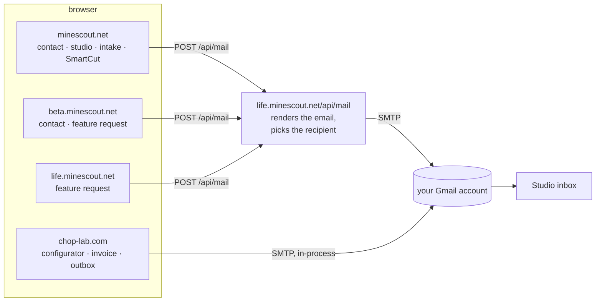

# Email setup — one SMTP account for every site

Every form on every Minescout site now sends through **one SMTP account**.
Nothing posts to Google Apps Script or EmailJS any more.

You do three things: make a Gmail App Password, put it in one `.env` file, and
restart the two servers. Ten minutes.

---

## How it fits together



- **`life.minescout.net`** runs the relay at `POST /api/mail`. The three static
  sites post form fields to it. The server builds the email and decides the
  recipient — a browser can never choose who the mail goes to.
- **`chop-lab.com`** sends from its own server process, because its order form
  attaches the customer's sketches and STLs.
- Both read the **same `.env` file**, so you configure SMTP once.

Nothing in a browser holds a password. That is why the static sites cannot send
mail by themselves, and why the relay exists.

---

## Step 1 — Make a Gmail App Password

Google blocks your normal password for SMTP. You need an App Password.

1. Sign in to the Google account you want the sites to send **from**.
2. Go to **Google Account → Security**.
3. Turn on **2-Step Verification** if it is off. App Passwords do not exist
   without it.
4. Open **App passwords** (search "App passwords" in the account settings, or go
   to <https://myaccount.google.com/apppasswords>).
5. Name it `Minescout sites` and click **Create**.
6. Copy the 16-character password. It looks like `abcd efgh ijkl mnop`. Spaces
   are fine — keep them or remove them, both work.

> Use a dedicated Google account if you can. That account is the `From:` address
> on every customer email, and its daily send limit (about 500 messages on a
> free account) is the ceiling for all the sites together.

---

## Step 2 — Create the `.env` file

The file lives in the **repo root** — the folder that contains `chop-lab.com/`,
`life.minescout.net/`, and `AGENTS.md`.

```bash
cd /path/to/workspace          # the repo root
cp .env.example .env
```

Now open `.env` and fill in the two lines that matter:

```dotenv
SMTP_USER=you@gmail.com
SMTP_PASSWORD=abcd efgh ijkl mnop
```

That is the whole requirement. Everything else in the file is optional and
commented out.

**Optional lines you may want:**

| Key | Default | What it does |
| --- | --- | --- |
| `STUDIO_INBOX` | `theminescout@minescout.net` | Where Minescout leads and messages land. |
| `SMTP_FROM_NAME` | `Minescout` | Display name on the Minescout `From:` line. |
| `SMTP_HOST` / `SMTP_PORT` | `smtp.gmail.com` / `587` | Use another provider, or `465` for implicit TLS. |
| `STUDIO_PASSCODE` | *(unset)* | Passcode for the Chop Lab `/invoice` tool. Unset falls back to the old Apps Script check. |

Rules the loader follows:

- A **non-empty** value in `.env` wins over your shell environment.
- An **empty** value is ignored, so a copied template never blanks a secret that
  is already set.
- `.env` is git-ignored. Never commit it. `.env.example` is the tracked template.
- A `chop-lab.com/.env` or `life.minescout.net/.env` also works and overrides the
  root file, but you do not need one.

### Where the mail lands

Two inboxes, both fixed in code so a browser can never pick a recipient:

| Sender | Destination | Change it in |
| --- | --- | --- |
| Minescout sites (contact, studio consult, intake, SmartCut, beta, Life) | `theminescout@minescout.net` | `STUDIO_INBOX` in `.env` |
| The Chop Lab (configurator, invoice, outbox resend) | `tmcarleton11@gmail.com` | `STUDIO_EMAIL` in `chop-lab.com/src/lib/studio-mail.ts` |

`.env` holds **credentials only** — the account that sends (`SMTP_USER`,
`SMTP_PASSWORD`) and optional knobs. Addresses live in code because the relay
must not accept one from the browser. So one `.env` configures sending for
every site; if you want the Minescout leads in the same Gmail inbox as the Chop
Lab ones, uncomment one line:

```dotenv
STUDIO_INBOX=tmcarleton11@gmail.com
```

Customer receipts (the intake confirmation and the Chop Lab receipt) always go
to the address the customer typed, never to either inbox above.

---

## Step 3 — Restart both servers

The `.env` is read at startup, so a running server will not see it.

```bash
# The relay (Life)
cd life.minescout.net && npm run dev

# The Chop Lab
cd chop-lab.com && npm run dev
```

If you run them under nginx as `my-sites.conf` describes, restart the services
that own `:3000` (Life) and `:8080` (Chop Lab). The static sites need no restart
— they only call the relay.

---

## Step 4 — Check it worked

**a. The relay reports SMTP is configured:**

```bash
curl -s https://life.minescout.net/api/mail
# {"ok":true,"configured":true}
```

`"configured":false` means the server did not read your `.env`. See the
troubleshooting table.

**b. The Chop Lab reports SMTP:**

Open <https://chop-lab.com/outbox>. It should say **"Order email is using
SMTP."** If it warns that email is not configured, the Chop Lab process has no
`SMTP_USER` / `SMTP_PASSWORD`.

**c. Send one real message from each site.** Use your own address in the
customer fields so you can see both copies:

| Site | Where | Expect |
| --- | --- | --- |
| minescout.net | `/contact` | One email to the studio inbox, `Reply-To` your address. |
| minescout.net | `/studio/creation` → claim form | One email with the consultation transcript. |
| minescout.net | `/studio/intake` | Two emails: the report to the studio, a receipt to the customer. |
| minescout.net | `/services/lawn-care` | One SmartCut lead to the studio inbox. |
| beta.minescout.net | `/email` and `/feature-requests` | One email each to the studio inbox. |
| life.minescout.net | `/pages/ai-posts` → feature request | One email to the studio inbox. |
| chop-lab.com | `/configure` → Finalize | Two emails: receipt to the customer, studio copy with attachments. |

If a send fails, the page says so and points at the queue or a `mailto:` link —
it never pretends to have sent.

---

## Step 5 — Deploy

`.env` is not in git, so a deploy has no file to read. Give the platform the same
keys as **environment variables**:

- Chop Lab (Vercel): `SMTP_USER`, `SMTP_PASSWORD`, optionally `STUDIO_PASSCODE`,
  `SMTP_HOST`, `SMTP_PORT`.
- Life: `SMTP_USER`, `SMTP_PASSWORD`, optionally `STUDIO_INBOX`,
  `SMTP_FROM_NAME`, `SMTP_HOST`, `SMTP_PORT`.

On the deploy there is no `.env`, so the injected environment is used. Nothing
needs to be committed.


## Ongoing delivery checks

The configuration checks prove that SMTP credentials exist; they do **not**
prove that a message reached an inbox. SMTP acceptance is not the same as
inbox delivery. While accepting real Chop Lab orders, run a small end-to-end
check at least monthly and after every SMTP, hosting, or mail-code change:

1. Submit an internal test request through `chop-lab.com/configure` using an
   address you control and one small PNG or JPG attachment.
2. Confirm the customer receipt arrives.
3. Confirm the studio notification arrives at the configured studio inbox,
   includes the expected filename, and has an attachment that opens correctly.
4. Check `chop-lab.com/outbox` on the browser used for the test. A successful
   delivery should leave no pending copy of that request. If a send failed,
   keep the queued request until the studio copy and receipt have been
   confirmed; use the queue's retry action rather than submitting a duplicate.
5. Send one low-risk test through a static-site form (for example,
   `minescout.net/contact`) and confirm the Life relay delivers it to the
   configured inbox.

Record the date, site, request ID, whether both messages arrived, and whether
the attachment opened. Do not put customer addresses, message bodies, file
contents, or SMTP credentials in the log.

**Important limits:** the Chop Lab outbox is stored in that browser's
`localStorage`; it is not a central server-side queue and does not sync across
devices. Clearing browser data can remove its retry records. The outbox's
SMTP status indicator only reports whether credentials are configured, while
a successful send response means the SMTP server accepted the message. Always
check the destination inbox (including spam) for the operational test.

If an attachment was too large to retain or send, the outbox flags that fact
and the studio notification should identify the file as not attached. Ask the
customer for a smaller file or a secure link; do not mark the order complete
until the required design files are actually available to the studio.

---

## Troubleshooting

| Symptom | Cause | Fix |
| --- | --- | --- |
| `{"configured":false}` from `/api/mail` | The server started before `.env` existed, or the file is in the wrong folder. | Confirm `.env` sits next to `AGENTS.md`, then restart Life. |
| `/outbox` warns email is not configured | Chop Lab has no SMTP keys. | Add them to the root `.env` and restart `npm run dev`. |
| `535-5.7.8 Username and Password not accepted` | Used the account password, or 2-Step Verification is off. | Make an App Password (Step 1) and paste all 16 characters. |
| `Invalid login` only on the deploy | The platform variables are missing or stale. | Re-check the env vars in the provider's dashboard, then redeploy. |
| `Too many messages from this connection` | Six sends from one IP in ten minutes. | Wait ten minutes. This is the spam guard. |
| `Attachments are too large` | Chop Lab caps attachments at 4 MB. | Ask the customer to send a smaller file, or send a link. |
| A form says it could not send, but the server log looks fine | The browser blocked the cross-origin request. | Check the site is on `https` and in the relay's origin allowlist (`life.minescout.net/vite.config.js`). |
| Nothing arrives and there is no error | Check spam, and check the sending account's quota. | Gmail's daily limit is about 500 messages. |

Server logs are the fastest signal. The relay logs one line per send:

```
[mail] sent minescout/contact-mwtlkgzp (1 message)
```

and a clear warning when it cannot send:

```
[mail] SMTP is not configured — add SMTP_USER and SMTP_PASSWORD to .env
```

---

## Why the relay does not trust the browser

An endpoint that emails whatever address the browser names is an open spam relay,
and Gmail would suspend the account within a day. So:

- The browser picks a **form name**, never a recipient. Recipients are constants
  in `life.minescout.net/server/mail.js`.
- Only the forms in `FORM_NAMES` are accepted; every other name is a `400`.
- Every field is length-capped and HTML-escaped before it reaches the template.
- The intake form emails the customer a **separate** confirmation, so the studio
  inbox is never exposed in a `To:` header.
- Six sends per IP per ten minutes, forty per hour, a 64 KB body cap, and a
  honeypot field that silently drops bot submissions.

---

## Where the code lives

| Piece | File |
| --- | --- |
| The relay, templates, rate limits | `life.minescout.net/server/mail.js` |
| `.env` loader for Life | `life.minescout.net/server/env.js` |
| `.env` loader for Chop Lab | `chop-lab.com/scripts/with-app-env.mjs` |
| Chop Lab SMTP send | `chop-lab.com/src/lib/studio-mail.ts` |
| Chop Lab delivery queue | `chop-lab.com/src/routes/outbox.tsx` |
| Minescout form client | `minescout.net/public/app.js` (`postStudioMail`) |
| SmartCut form client | `minescout.net/public/services/lawn-care/index.html` |
| Beta form clients | `beta.minescout.net/email.html`, `feature-requests.html` |
| Life feature request | `life.minescout.net/src/pages/CategoryPage.jsx` |
