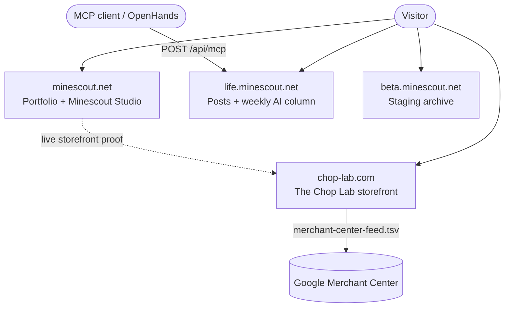

# The Minescout Workspace

[](https://github.com/TheMinescout/workspace/actions/workflows/ci.yml)
[](https://minescout.net)
[](https://life.minescout.net)
[](https://beta.minescout.net)
[](https://chop-lab.com)
[](https://react.dev)
[](https://tanstack.com/start)
[](https://www.typescriptlang.org)
[](https://threejs.org)

> [!TIP]
> **Want to work with me?**
>
> - **Minescout Studio** — custom websites, storefronts, and fast static sites for small businesses, students, clubs, and nonprofits. Start at **[minescout.net/studio](https://minescout.net/studio)**.
> - **The Chop Lab** — custom 3D-printed pottery tools, CAD modelling, and STL printing. Start at **[chop-lab.com](https://chop-lab.com)**.

This repository is the home of **The Minescout**: four separate web properties that share a
design language and a deployment box, but not a runtime. Each site is independently runnable,
independently tested, and independently deployed. The portfolio site and The Chop Lab are the two
front doors; Minescout Life is the long-form blog and the AI column; Minescout Beta is the
experimental archive.

## The ecosystem

| Site | Live | What it is | Stack |
| --- | --- | --- | --- |
| **Minescout** | [minescout.net](https://minescout.net) | Personal portfolio, blog, and **Minescout Studio** (client web design and storefronts). | Static HTML/CSS/ES modules — no framework, no build step |
| **Minescout Life** | [life.minescout.net](https://life.minescout.net) | Personal publishing site: posts, categories, comments, ratings, admin editor, and the weekly AI column. | React 19, React Router 7, Vite 8, file-based JSON posts |
| **Minescout Beta** | [beta.minescout.net](https://beta.minescout.net) | Terminal-style staging archive for experiments, release notes, and legacy snapshots. | Static HTML/JS with clean-URL routing |
| **The Chop Lab** | [chop-lab.com](https://chop-lab.com) | Storefront and configurator for custom 3D-printed pottery tools, STL files, and CAD/print services. | React 19, TanStack Start/Router, TypeScript, Tailwind v4, Three.js, Nitro |



## Repository layout

```text
workspace/
├── minescout.net/
│   ├── public/              # SPA shell, app.js, views.js, main.css, blog + studio views
│   └── scripts/             # node:test suites for blog posts and Studio pages
├── life.minescout.net/
│   ├── public/posts/        # <id>.json + manifest.json — the content store
│   ├── public/assests/      # post images and generated title cards
│   ├── server/              # MCP server, post store, title-card renderer, bundled fonts
│   ├── scripts/             # unit, render, and MCP smoke tests
│   └── src/                 # React app: components, data, hooks, lib, pages
├── beta.minescout.net/      # static terminal site, article/project archive
├── chop-lab.com/
│   ├── migrations/          # SQL migrations (Better Auth)
│   ├── public/              # product photos, STL files, sitemap, merchant feed
│   ├── scripts/             # feed, PWA, smoke, preview, and QA scripts
│   ├── server/              # Nitro middleware (PWA install page and manifest)
│   └── src/                 # routes, components, and lib (products, SEO, auth, db)
├── .github/workflows/       # ci.yml, pages.yml
├── my-sites.conf            # nginx virtual hosts and reverse proxies
├── AGENTS.md                # repo-wide agent notes
└── README.md
```

## Minescout — portfolio and Studio (`minescout.net`)

The main site is a deliberately build-free SPA. `public/index.html` mounts `<main id="app">` and
loads `public/app.js`, which renders route templates from `public/views.js`. Styling lives in
`public/main.css`; images and the resume PDF live in `public/assets/`. There is no bundler, no
`node_modules`, and no deploy step beyond copying `public/`.

### Routes

| Route | Page |
| --- | --- |
| [`/`](https://minescout.net/) | Home and hero |
| [`/work`](https://minescout.net/work), [`/about`](https://minescout.net/about), [`/resume`](https://minescout.net/resume) | Portfolio, bio, and resume |
| [`/now`](https://minescout.net/now), [`/photography`](https://minescout.net/photography) | Now page and photo gallery |
| [`/blog`](https://minescout.net/blog) | Blog index, built from `BLOG_POSTS` |
| [`/blog/<slug>.html`](https://minescout.net/blog/chop-lab-storefront.html) | Individual post views registered with `registerPost()` |
| [`/studio`](https://minescout.net/studio) | Minescout Studio landing page |
| [`/studio/pricing`](https://minescout.net/studio/pricing), [`/studio/process`](https://minescout.net/studio/process), [`/studio/clients`](https://minescout.net/studio/clients), [`/studio/tools`](https://minescout.net/studio/tools), [`/studio/roi`](https://minescout.net/studio/roi), [`/studio/legal`](https://minescout.net/studio/legal), [`/studio/creation`](https://minescout.net/studio/creation), [`/studio/review`](https://minescout.net/studio/review), [`/studio/admin`](https://minescout.net/studio/admin), [`/studio/info`](https://minescout.net/studio/info) | Studio pages |
| [`/studio/local-web-design`](https://minescout.net/studio/local-web-design), [`/studio/custom-storefronts`](https://minescout.net/studio/custom-storefronts), [`/studio/student-nonprofit`](https://minescout.net/studio/student-nonprofit) | Service landing pages with their own SEO metadata |
| [`/studio/intake`](https://minescout.net/studio/intake) | Project intake form |
| [`/portal`](https://minescout.net/portal), [`/studio/clients/portal`](https://minescout.net/studio/clients/portal) | Client portals |
| [`/contact`](https://minescout.net/contact), [`/guestbook`](https://minescout.net/guestbook), [`/ask`](https://minescout.net/ask) | Contact, guestbook, and Q&A |
| [`/services/lawn-care`](https://minescout.net/services/lawn-care), [`/services/coin-data`](https://minescout.net/services/coin-data), [`/services/donations`](https://minescout.net/services/donations) | Static service demos served as real files |
| [`/legal`](https://minescout.net/legal), `/404.html` | Legal and not-found pages |

### How the SPA fits together

- `public/views.js` is the whole template module: the `views` map, `BLOG_POSTS` index metadata,
  `registerPost()` for post bodies, and `PAGE_META` / `SITE_META` for per-route document titles.
- `registerPost(route, date, …)` only defines a view when `isReleased(date)` is true, so a
  future-dated post is invisible on the index **and** 404s on direct navigation.
- `PAGE_META` overrides `<title>`, description, and `og:*` for routes that need their own search
  intent; every other route falls back to `SITE_META`.
- Cache busting is manual: bump `?v=` on the `app.js` tag in `index.html`, and on the `views.js`
  import in `app.js`, after editing either file.
- `public/sitemap.xml` and `public/robots.txt` are static. A post needs an index entry, a
  `registerPost()` call, a tag colour in `main.css` (`.tag-*`, in two blocks), and a sitemap
  entry to be complete.
- Nginx serves `minescout.net/public` with SPA fallback, real files under `/services/` (and
  `/ai/` when present), and a seven-day cache on static assets.

### Checks

```bash
cd minescout.net
npm test        # node --test scripts/*.test.mjs — 21 assertions, no build required
```

`scripts/blog-posts.test.mjs` guards the blog index, released dates, and sitemap coverage.
`scripts/studio-pages.test.mjs` guards the three service pages: unique H1s, `PAGE_META` titles and
descriptions, CTA links, sitemap entries, and that every dollar figure also appears on
`/studio/pricing`.

## Minescout Life (`life.minescout.net`)

Minescout Life is a React application over a **file-based content store** — there is no Firebase and
no external database. Posts are JSON files served from `public/posts/`; the admin editor and the
MCP server both write through the same store, so an agent-authored post and a hand-authored one
are identical in shape.

### Routes

| Route | Page |
| --- | --- |
| [`/`](https://life.minescout.net/) | Home timeline (`homePosts`, which hides the AI column) |
| [`/about`](https://life.minescout.net/about) | About |
| [`/login`](https://life.minescout.net/login) | Sign in |
| [`/admin`](https://life.minescout.net/admin) | Admin editor (admin only) |
| [`/post/:id`](https://life.minescout.net/post/argon-and-carbon-gemini-4-elements) | Single post |
| [`/pages/coding-projects`](https://life.minescout.net/pages/coding-projects), [`/pages/tech-tips`](https://life.minescout.net/pages/tech-tips), [`/pages/updates`](https://life.minescout.net/pages/updates), [`/pages/puppy-life`](https://life.minescout.net/pages/puppy-life), [`/pages/minecraft-server`](https://life.minescout.net/pages/minecraft-server), [`/pages/beta`](https://life.minescout.net/pages/beta), [`/pages/stats`](https://life.minescout.net/pages/stats), [`/pages/feature-request`](https://life.minescout.net/pages/feature-request), [`/pages/ai-posts`](https://life.minescout.net/pages/ai-posts) | Category pages |
| `*` | Not found |

### Posts are files, not a database

- `public/posts/<id>.json` holds one post; `public/posts/manifest.json` is the index the app
  fetches. `src/data/posts.js` loads them and owns visibility: `visiblePosts(posts, isAdmin)` is
  the single gate for scheduled posts, and `homePosts()` removes the AI column from the home feed.
- `src/lib/scheduling.js` parses every date shape a post can carry (`November 14, 2026`,
  `14 November 2026`, `2026-11-14`, `11/14/2026`) and decides whether a post is live or scheduled.
  A future `publishDate` or show `date` keeps a post hidden from non-admins everywhere.
- Incoming content is sanitized in `server/security.js` and normalized in `server/posts-store.js`.
  Markdown is converted to HTML by `marked` on the MCP path; the app renders the stored HTML.
- Runtime state that is not content — users, comments, ratings — lives in `data/`, which is
  gitignored.
- Set `publishDate` to a future time to schedule a post; pass an empty string when updating to
  publish it immediately.

### Local development and checks

```bash
cd life.minescout.net
npm install
npm run dev       # Vite dev server on 127.0.0.1:3000
npm run check     # lint, build, unit tests, render smoke, MCP smoke
```

| Command | What it does |
| --- | --- |
| `npm run dev` | Vite dev server on `127.0.0.1:3000`, including the API and MCP endpoint |
| `npm run build` | Production build to `dist/` |
| `npm run preview` | Serve the build (frontend only — no API) |
| `npm run lint` | Oxlint |
| `npm test` | Scheduling, content, security, and title-card unit tests |
| `npm run smoke` | Build, then Playwright render smoke over the key routes |
| `npm run mcp:smoke` | Drive `/api/mcp` with a real MCP client against a scratch store |
| `npm run check` | All of the above in order |

> [!IMPORTANT]
> The API is a **dev-server-only Vite plugin** (`apiPlugin` in `vite.config.js`, mounted in
> `configureServer`). It has no `configurePreviewServer` counterpart, so `vite preview` and the
> GitHub Pages build serve the public site without comments, ratings, or admin sign-in.

<details>
<summary><strong>Local API surface</strong></summary>

`/api/` is proxied to the app server by nginx and covers the site's non-content state:

| Endpoint | Purpose |
| --- | --- |
| `/api/save-post`, `/api/delete-post` | Admin post writes |
| `/api/sidebar-config` | Sidebar links |
| `/api/comments`, `/api/comments/all`, `/api/comments/delete` | Post comments |
| `/api/ratings` | Post ratings |
| `/api/admin/login`, `/api/admin/session`, `/api/admin/logout` | Admin session |
| `/api/register`, `/api/login`, `/api/me`, `/api/logout`, `/api/reset-password` | Reader accounts |
| `/api/vault`, `/api/vault/hack/*`, `/api/vault/files` | The terminal vault mini-game |
| `/api/mcp` | The MCP server (see below) |

`/data/` is served cross-origin to `beta.minescout.net` so the beta site can authenticate against
the same user list.

</details>

### MCP server — let an agent write posts

`POST /api/mcp` exposes a [Model Context Protocol](https://modelcontextprotocol.io) server
(`server/mcp.js`). An MCP client can list, read, create, edit, and delete posts through the same
storage path the admin editor uses. It also exposes the title-card recipe as the
`how-to-make-a-title` resource and the `make_title_image` prompt.

| Tool | Purpose |
| --- | --- |
| `list_posts` | List posts, newest first. Optional `category` filter. |
| `get_post` | Fetch one post in full, including its content. |
| `create_post` | Publish a new post. Markdown or HTML. Optional `titleImage` renders a hero card in the same call. |
| `update_post` | Edit an existing post. Only the fields you pass change. |
| `delete_post` | Permanently delete a post. |
| `create_title_image` | Render a title card on the server and save it to the site. |
| `render_title_card_html` | Return the card's HTML for client-side screenshotting. |
| `upload_title_image` | Store a PNG rendered elsewhere as the post's title card. |

Every request needs `Authorization: Bearer <token>`, because these tools publish to the live site.
The token is read from `MCP_TOKEN`; without it the endpoint is disabled and returns `503`, and a
wrong or missing token gets `401`. The token is never committed — keep it in the workspace-root
`.env`, which is gitignored. That one file also carries the SMTP account every site sends mail
through; see [`EMAIL-SETUP.md`](EMAIL-SETUP.md).

<details>
<summary><strong>MCP payloads and client setup</strong></summary>

```jsonc
// create_title_image
{
  "title": "Argon and Carbon",        // headline — short fits one line
  "accentWord": "Carbon",             // one word set in green
  "subtitle": "The periodic table inside Gemini 4",
  "category": "Tech",
  "date": "November 2026",
  "models": [                          // optional comparison footer (max 4)
    { "name": "Gemini 4 Argon", "meta": "1M tokens", "color": "accent" },
    { "name": "Gemini 4 Carbon", "meta": "AA 59", "color": "blue" }
  ]
}
```

It returns the hero path, e.g. `/assests/images/tech/argon-and-carbon-title.png`. Or let
`create_post` render the card in the same call:

```jsonc
// create_post
{
  "title": "My New Post",
  "summary": "One-line teaser.",
  "content": "## Markdown works",
  "titleImage": { "subtitle": "A subtitle for the card" }
}
```

`color` takes a design-token name (`accent`, `blue`, `amber`, `red`) or a hex value; the headline
size steps down automatically for long titles. The asset folder is spelled `assests` (not
`assets`) — that is the site's long-standing path and it must match exactly.

Point a client at `https://life.minescout.net/api/mcp`:

```json
{
  "mcpServers": {
    "minescout-life": {
      "type": "http",
      "url": "https://life.minescout.net/api/mcp",
      "headers": { "Authorization": "Bearer YOUR_TOKEN_HERE" }
    }
  }
}
```

Once connected:

> "Write a post about this week's Eagle Scout progress and publish it."

</details>

### Title images

`create_title_image` builds a 1600×900 card (3200×1800 at `scale: 2`) and saves it under
`public/assests/images/<folder>/` as a PNG plus the source HTML. There is no image generator in
this environment, so the card is **designed from the site's own tokens** — real fonts, real
colours — which keeps every post header in the same family and every card reproducible from a
text file in version control.

<details>
<summary><strong>Renderers, fonts, and the client-side escape hatch</strong></summary>

- The default renderer is pure JavaScript: `server/title-image-render.js` lays the card out with
  `satori` and rasterizes it with `@resvg/resvg-js`. It needs no browser and no network, so it
  works on hosts where Chromium cannot start.
- `renderer: "browser"` (or `TITLE_IMAGE_RENDERER=browser`) photographs the card HTML in headless
  Chromium through Playwright. Use it for pixel QA of the default renderer; it requires
  `CHROMIUM_PATH`, `/usr/bin/chromium`, or Playwright's bundled build.
- The card design tokens live in `server/title-image.js`; the how-to text lives in
  `server/title-image-guide.js` and is mirrored in
  `public/assests/images/how-to-make-a-title.txt`. Keep the renderer and `buildCardHtml` drawing
  the same card — `scripts/title-image-render.test.mjs` asserts every band has ink.
- Fonts (Lora, Inter, JetBrains Mono) are bundled in `server/fonts/` and embedded as base64
  `@font-face` rules. `satori` matches an exact numeric weight, so each weight the card uses is
  registered; a variable font registered only at 400 makes the 700 headline render thin. The tool
  reports `fontsLoaded` so a fallback card is visible rather than silent.
- Client-side render is optional, never required: `render_title_card_html` returns the card URL,
  screenshot it at 1600×900 anywhere a browser works, then `upload_title_image` (or
  `titleImage.pngBase64`) stores the PNG. The server still owns storage and naming, so the path is
  identical. Keep uploads under ~1 MB (nginx's default body limit); prefer `scale: 1`.
- `IMAGES_DIR` and `POSTS_DIR` override the storage locations for tests.
- Commit both the PNG and its source HTML so the card stays reproducible; nothing else needs
  deploying.

</details>

### The weekly AI column

`AI Posts` is a category kept **off the home timeline** and shown only on its own tab
(`/pages/ai-posts`, linked as "AI Posts" in the sidebar). The point is a weekly AI-written column:
an agent publishes one entry a week through the MCP `create_post` tool with
`category: "AI Posts"`, and it appears on the tab without crowding the main feed.

- `isAICategory(post)` in `src/data/posts.js` matches the whole word "ai", so "AI Posts" and a
  bare "AI" count while "Coding", "Tech", and "Puppy" do not. `homePosts()` is `visiblePosts()`
  minus those posts; every other view still uses `visiblePosts()`.
- Direct links (`/post/<id>`) and the category tab work normally, so a shared AI post opens fine.
- Scheduling still applies: a future-dated AI post is hidden from non-admins everywhere.

<details>
<summary><strong>Weekly automation payload</strong></summary>

The weekly drop is a scheduled OpenHands conversation that calls `POST /api/mcp` with
`create_post`:

```jsonc
{
  "title": "…",                    // this week's topic
  "summary": "One-line teaser.",
  "content": "## Markdown body",
  "category": "AI Posts",
  "titleImage": { "subtitle": "This week in AI" }
}
```

It needs the MCP token; the title card needs no network access. See the automation's own config
for the schedule and prompt. The site only requires `category: "AI Posts"`.

</details>

## Minescout Beta (`beta.minescout.net`)

Beta is a static, terminal-styled archive — "ATLS // Minescout" — used for release notes,
experiments, and historical snapshots. There is no framework and no build step; `assets/js/`
contains the terminal shell, filesystem registry, auth, and form hardening.

| Route | Page |
| --- | --- |
| [`/`](https://beta.minescout.net/) | Terminal home |
| [`/pages`](https://beta.minescout.net/pages) | Article index (`content/articles/*`) |
| [`/projects`](https://beta.minescout.net/projects) | Project index (`content/projects/*`) |
| [`/feature-requests`](https://beta.minescout.net/feature-requests) | Feature request board |
| [`/email`](https://beta.minescout.net/email) | Contact form |
| [`/login`](https://beta.minescout.net/login) | Account sign-in |
| [`/admin-messages`](https://beta.minescout.net/admin-messages) | Admin message view |
| `/content/articles/<slug>`, `/content/projects/<slug>` | Individual entries |

- **Clean URLs:** nginx rewrites `/index.html` to `/`, redirects legacy `.html` URLs to
  extensionless paths, resolves extensionless paths to the matching `.html` file, and serves
  `404.html` for misses. `nginx-beta.minescout.net.txt` documents the same block.
- **Auth:** `assets/js/auth.js` replaced Firebase Auth. It verifies users against
  `life.minescout.net/data/users.json` with a SHA-256 hash, keeps a 12-hour session in
  `sessionStorage`, and fires `auth-ready`. The old `firebase-config.js` remains in the tree but is
  not the active path.
- **Hardening:** `assets/js/security.js` rate-limits form submissions (three per 30 seconds) as
  defense in depth.
- Beta is experimental; its page structure can change faster than the production sites.

## The Chop Lab (`chop-lab.com`)

The Chop Lab is the most application-heavy project in the workspace: a typed React storefront
built on TanStack Start/Router and Vite, with a Nitro server layer, Tailwind v4, Radix UI, and
Three.js for interactive 3D previews. Product data is static and typed in `src/lib/products.ts`;
auth and database helpers are pre-wired but opt-in.

### Routes

| Route | Page |
| --- | --- |
| [`/`](https://chop-lab.com/) | Home, featured tool, texture previews, FAQ |
| [`/tools`](https://chop-lab.com/tools) | Catalogue, grouped by category |
| [`/tools/custom-3d-print`](https://chop-lab.com/tools/custom-3d-print) | Custom STL/CAD printing service |
| [`/tools/<slug>`](https://chop-lab.com/tools/texture-roller-10) | Product detail for all ten catalogue entries |
| [`/3d-printing`](https://chop-lab.com/3d-printing) | Custom 3D printing and rapid prototyping service page |
| [`/configure`](https://chop-lab.com/configure) | Configurator / consultation form (`?product=…&texture=…`) |
| [`/files`](https://chop-lab.com/files) | Digital STL downloads |
| [`/engineering-drawings`](https://chop-lab.com/engineering-drawings) | Drawing and blueprint views |
| [`/about`](https://chop-lab.com/about), [`/faq`](https://chop-lab.com/faq) | About and FAQ |
| [`/invoice`](https://chop-lab.com/invoice) | Passcode-gated studio invoice tool (`noindex`) |
| `*` | Not found |

### Products, pricing, and the configurator

- `src/lib/products.ts` holds the catalogue: **ten products**, seven physical and three digital
  STL files, across five categories (custom printing, chops and textures, storage, slab and
  handbuilding, digital files). `quoteFor(product)` is the single pricing function.
- The configurator (`/configure`) collects a logo, sketch, or dimensions and ends in a review
  request — no payment is collected. An invoice follows the CAD review.
- All lengths are stored canonically in **millimetres**; `useLength()` and `<Length mm={…} />`
  apply the display unit (`mm`/`in`) at render time, so a unit switch re-renders every measurement.
- SEO uses `pageHead()` from `src/lib/seo.ts`, which sets title, description, canonical URL, and
  optional JSON-LD. Product pages emit `Product` structured data with the same `quoteFor()` price
  the page renders.
- Reusable components cover the storefront surfaces: product cards and galleries, chop and texture
  previews, STL thumbnails, blueprint viewers, tool drawings, the consultation form, and the
  preview-host bridge.

### Merchant Center feed

`public/merchant-center-feed.tsv` is generated, never hand-edited:

```bash
cd chop-lab.com
npm run feed:merchant              # regenerate from PRODUCTS
npm run feed:merchant -- --check   # exit 1 if the committed feed is stale
```

The feed lists only physical products that have a photo. Digital STLs are skipped because
Merchant Center has no listing type for downloadable goods, and `sponge-basket` / `slab-rails` are
skipped until they get a real photo and a `product.image`. `scripts/merchant-feed.test.mjs` fails
when the committed file drifts from `products.ts`.

### Commands and quality gate

```bash
cd chop-lab.com
npm install
npm run dev          # Vite dev server on 0.0.0.0:8080
```

| Command | What it does |
| --- | --- |
| `npm run dev` | Dev server on `0.0.0.0:8080` (the platform preview contract) |
| `npm run build` | Vite build with the Nitro `vercel` preset, then `db:migrate` |
| `npm run preview` | Built-output QA preview on `127.0.0.1:8081` |
| `npm run preview:restart`, `npm run preview:stop` | Restart or stop the QA preview |
| `npm run typecheck` | `tsc --noEmit` |
| `npm run lint` | ESLint |
| `npm test` | `node:test` suites in `scripts/` plus three TypeScript suites in `src/lib` |
| `npm run check:auth` | Auth-invariant check against the dev server |
| `npm run db:migrate` | Apply SQL migrations |
| `npm run format` | Prettier |

A change is done when:

1. `npm run typecheck` is clean.
2. `npm run build` succeeds.
3. `node scripts/browser-smoke.mjs <url> <out.png>` returns a clean verdict for desktop
   (1280×800) and mobile (390×844): non-blank body text, no console or page errors, no horizontal
   overflow. Inspect the screenshots it writes.

> [!NOTE]
> `npm test` carries a set of pre-existing failures unrelated to most work: they read App Builder
> template scaffolding this repo does not ship, and the PWA plugin expects the document `<title>`
> to drive `og:title` while `src/lib/og/site.json` pins the card title to "The Chop Lab". Compare
> the failing count before and after a change rather than expecting a fully green run.

### Deployment: Nitro on Vercel

Production is a **Vercel deployment**. `npm run build` compiles through TanStack Start and Nitro
with `preset: "vercel"`, writing `.vercel/output` (untracked). The Nitro `serverDir` setting keeps
`server/middleware/*` wired, which is what serves the PWA install page and manifest on a deploy.

The `chop-lab.com` block in `my-sites.conf` is a **different** path: it reverse-proxies the domain
to the Vite dev server on `localhost:8080` in this sandbox, with WebSocket headers for HMR. The
two must not be confused — nginx is the local/self-host route; Vercel is production. `startup.sh`
is the sandbox revive contract and brings the dev server back on `:8080`.

## Deployment topology

`my-sites.conf` is both server configuration and deployment documentation:

| Host | Served by | Backing process | Notes |
| --- | --- | --- | --- |
| `minescout.net`, `www.minescout.net` | nginx static root: `/usr/share/nginx/html/minescout.net/public` | — | SPA fallback, real files under `/services/`, seven-day asset cache, `404.html` |
| `life.minescout.net` | nginx reverse proxy | Vite/app server on `localhost:3000` | WebSocket/HMR, `/api/` and `/data/` proxied, `/data/` CORS for beta |
| `beta.minescout.net` | nginx static root: `/usr/share/nginx/html/beta.minescout.net` | — | Clean URLs, `.html` → extensionless 301, `404.html` |
| `chop-lab.com`, `www.chop-lab.com` | nginx reverse proxy | Vite dev server on `localhost:8080` | WebSocket/HMR; production is the Vercel build, not this vhost |
| `tools.minescout.net` | nginx reverse proxy | React/Vite dashboard on `localhost:5173` | Configured in nginx only; its source is not in this repository |
| Any other host / raw IP | nginx `default_server` | — | Connection dropped (`444`) |

The static sites are copied into `/usr/share/nginx/html/`; the two application sites are proxied.
Minescout Life also publishes a static GitHub Pages preview, which has no API.

## Technology overview

| Area | Tools |
| --- | --- |
| **Frontend** | React 19, TanStack Start/Router/Query/Table, React Router 7, TypeScript, Tailwind CSS v4, Radix UI, Three.js |
| **Build-free sites** | Vanilla HTML, CSS custom properties, ES modules (`minescout.net`, `beta.minescout.net`) |
| **Content** | File-based JSON posts and manifests; static `views.js` templates; Markdown via `marked` |
| **Life backend** | Vite dev middleware, MCP SDK, file storage, SHA-256/session auth, sanitizing HTML pipeline |
| **Chop Lab backend** | TanStack Start server functions, Nitro, Kysely, PGlite/PostgreSQL, Better Auth, Zod |
| **Images and QA** | Satori + Resvg title cards, Playwright screenshots and render smoke tests |
| **Tooling** | Vite 8, Oxlint, ESLint, Prettier, `node:test`, TypeScript |
| **Hosting** | nginx (static + reverse proxy), Vercel (Chop Lab), GitHub Pages (Life static preview) |

## Continuous integration

| Workflow | Trigger | What runs |
| --- | --- | --- |
| [`ci.yml`](.github/workflows/ci.yml) | Push to `main` or a PR touching `life.minescout.net/**` or `minescout.net/**`; manual | **Life:** install, lint, build, unit tests, Chromium render smoke, MCP smoke. **Minescout:** blog and Studio tests |
| [`pages.yml`](.github/workflows/pages.yml) | Push to `main` touching `life.minescout.net/**`; manual | Builds Life with `GH_PAGES_BASE`, adds `404.html` and `.nojekyll`, publishes to GitHub Pages |

The Chop Lab has no CI workflow; its quality gate runs by hand with the commands above.

## Working in the repository

Each property is independently runnable from its own directory:

```bash
# Minescout — no install, no build
cd minescout.net && npm test

# Minescout Life
cd life.minescout.net && npm install && npm run dev
cd life.minescout.net && npm run check

# Minescout Beta — static files, no build
cd beta.minescout.net

# The Chop Lab
cd chop-lab.com && npm run dev
cd chop-lab.com && npm run typecheck && npm run build
cd chop-lab.com && node scripts/browser-smoke.mjs http://127.0.0.1:8081/ /tmp/chop-lab.png
```

Before changing a site, read its `AGENTS.md` (repo root and `chop-lab.com/AGENTS.md`). They record
the port contracts, the PWA and SEO constraints, the measurement-unit rule, and the test baselines
that are easy to break by accident. Generated output — `life.minescout.net/dist`, `data/`,
`chop-lab.com/.vercel` — is not source.

## Contact

- **Minescout / Minescout Studio:** thomas@minescout.net
- **The Chop Lab:** thomas@chop-lab.com
- **Minescout Life and Beta:** theminescout@minescout.net

© 2026 The Minescout ecosystem and The Chop Lab.
